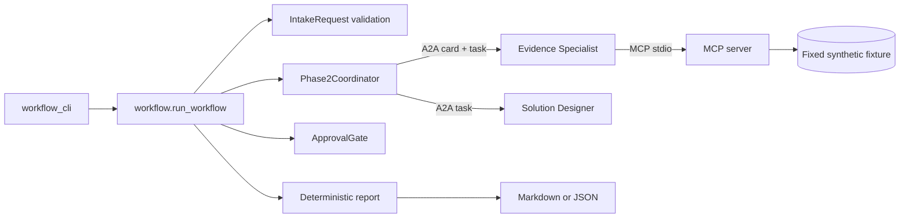

# Transformation Workbench architecture

**Status: portfolio demonstration.** The Workbench is a read-only,
synthetic-data decision-support demo. It is not a production service, does not
connect to a business system, and does not execute consequential actions.

## Design goal

The demo shows a bounded chain from a synthetic intake request to a reviewed
decision brief:

1. Validate the request and its selectors before work starts.
2. Read fixed evidence through read-only MCP tools.
3. Pass typed evidence to a local solution designer over A2A.
4. Render a provenance-linked report in deterministic code.
5. Pause at a review checkpoint that cannot execute an action.

The report is the authoritative output. Model prose is not part of the
authoritative path.

## Components

The local A2A runtime binds both specialists to ephemeral `127.0.0.1` ports.
The Workbench MCP child is launched over stdio with a fixed module entry point;
no caller-supplied path, command, or URL is accepted.

## Request and evidence boundary

`IntakeRequest` bounds the request ID, desired outcome, process label, notes, and
case IDs. Untrusted text is scanned for instruction-override, credential, and
action-request patterns. Case IDs must be short synthetic identifiers; path-like
selectors are rejected before any A2A or MCP call.

The Evidence Specialist reads `workbench://process-context` and calls only:

- `calculate_baseline_metrics`
- `list_case_exceptions`
- `get_case_details`

All measured facts carry tool/resource provenance. The coordinator recomputes
the fixed fixture and rejects mismatched metrics, exceptions, case observations,
request IDs, or case sets.

## Typed handoffs

The A2A handoffs are Pydantic contracts, not free-form model output:

- `EvidencePack` carries contract/version identifiers, provenance, all baseline
  metrics, exceptions, requested case observations, missing-data markers, and
  tool-error markers.
- `SolutionOptions` carries proposals with evidence-linked rationale,
  trade-offs, assumptions, validation steps, and limits. It has no measured
  value field.

Unknown evidence references, unsupported financial claims, and request
mismatches are rejected before rendering.

## Review checkpoint

`ApprovalGate` is a three-state demo state machine:

- `pending`: the default; no action is permitted.
- `approved`: a CLI caller supplied the matching stable reference.
- `declined`: a CLI caller supplied the matching reference and declined.

Even after approval, `execute_consequential_action()` raises
`consequential_action_disabled`. The checkpoint records a CLI-asserted review
decision; it is not identity verification and not an action authorization.

## Implemented behavior

- Deterministic KPI calculations over the packaged synthetic fixture.
- Read-only MCP tools with no arbitrary shell or filesystem surface.
- Local A2A discovery, task exchange, typed handoffs, and bounded failures.
- End-to-end CLI with markdown and JSON output.
- Intake validation, case-ID validation, fixed-evidence verification, and claim
  guards.
- Enforceable demo approval state machine and 249 automated tests at the current
  review snapshot.

## Not implemented

- Any write, ticket, email, browser, shell, or business-action tool.
- Real business data or external system integration.
- Hosted model operation in the Workbench path.
- Production authentication, authorization, audit persistence, deployment, or
  high availability.
- Gateway, sandbox, environment-host, or router integrations.
- Financial savings, ROI, or productivity commitments.

## Related documents

- [Threat model](threat-model.md)
- [Evaluation](evaluation.md)
- [Business case](business-case.md)
- [End-to-end demo](../demos/end-to-end-demo.md)
